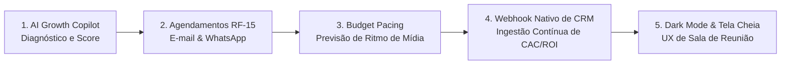
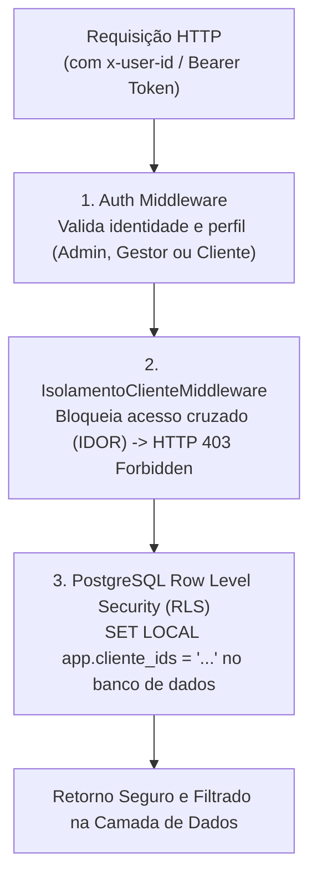

# 🚀 GrowMetrics Analytics - Plataforma de BI & Analytics Multicliente
### Sistema Centralizado de Inteligência de Marketing para Agências Digitais

[](https://github.com/PauloHFA/Dashboard-Analytics/actions)
[](apps/api/test)
[](scripts/acceptance_check.ts)
[](packages/shared)
[](apps/web)
[](docker-compose.yml)
[](database/migrations/001_initial_schema.sql)

O **GrowMetrics Analytics** é uma plataforma corporativa completa de Business Intelligence (BI) e Analytics voltada para agências de marketing digital de alta performance. O sistema consolida, normaliza e apresenta dados de campanhas pagas (**Google Ads**, **Meta Ads**), tráfego web (**Google Analytics 4**), audiência social (**Instagram Graph API**) e faturamento comercial (**CRM e Entradas Manuais**), gerenciando com segurança carteiras com mais de **60 clientes simultâneos** sob isolamento rigoroso de dados (**Multi-tenancy com Row Level Security**).

---

## 📑 Sumário Executivo

1. [Visão Geral & Desafios Resolvidos](#-visão-geral--desafios-resolvidos)
2. [5 Inovações de Alto Impacto (Além do Escopo Base)](#-5-inovações-de-alto-impacto-além-do-escopo-base)
3. [Arquitetura do Projeto (Monorepo)](#-arquitetura-do-projeto-monorepo)
4. [Dicionário de Métricas & Rigor Matemático](#-dicionário-de-métricas--rigor-matemático)
5. [Segurança Multitenant em Três Camadas (Defesa em Profundidade)](#-segurança-multitenant-em-três-camadas)
6. [Guia de Telas e Módulos do Sistema](#-guia-de-telas-e-módulos-do-sistema)
7. [Como Executar o Projeto](#-como-executar-o-projeto)
8. [Matriz de Testes & Critérios de Aceite (Seção 14 do Edital)](#-matriz-de-testes--critérios-de-aceite)
9. [Perfis de Acesso & Credenciais de Homologação](#-perfis-de-acesso--credenciais-de-homologação)
10. [Documentação Técnica Completa](#-documentação-técnica-completa)

---

## 🎯 Visão Geral & Desafios Resolvidos

Tradicionalmente, agências de marketing digital enfrentam três gargalos operacionais críticos:

1. **Dispersão e Lentidão de Relatórios**: Gestores de tráfego gastam até 30% da semana exportando planilhas do Google Ads, Meta Ads e GA4, consolidando dados manualmente em apresentações estáticas que já nascem desatualizadas.
2. **O Desafio do CAC e ROI Reais (Seção 4.2 do PDF)**: As APIs de anúncios reportam impressões, cliques, custos e conversões de leads, mas **não possuem visibilidade sobre vendas fechadas e receita faturada**. Sem integração comercial, métricas executivas como CAC (*Custo de Aquisição de Clientes*) e ROI (*Retorno sobre Investimento*) tornam-se impossíveis de mensurar.
3. **Risco de Vazamento de Dados entre Clientes Concorrentes**: Em agências com dezenas de clientes, um simples erro em filtros de URL ou permissões de BI pode expor dados de faturamento de um cliente a outro (vulnerabilidade IDOR).

O **GrowMetrics Analytics** resolve esses problemas com:
* **Conectores Oficiais e Padronizados**: GA4, Google Ads, Meta Ads e Instagram Insights (com suporte à métrica moderna de *Views* da Meta).
* **Quase Tempo Real (Near Real-Time)**: Sincronização inteligente com tolerância de até 60 minutos, indicadores de frescor dos dados e reconexão automática ao refocar a aba.
* **Isolamento Absoluto**: O cliente final visualiza apenas os dados de sua empresa, enquanto diretores e gestores da agência auditam a carteira inteira com troca instantânea de cliente.
* **Fechamento Automático de CAC e ROI**: Módulo duplo de ingestão — tela de lançamentos manuais para empresas sem CRM e **Webhook REST nativo** para integração com RD Station, HubSpot e PipeRun.

---

## 🌟 5 Inovações de Alto Impacto (Além do Escopo Base)

Para elevar o painel ao patamar de um **SaaS de BI Inteligente Enterprise**, foram desenvolvidos 5 módulos de alto valor agregado:



### 1. 🤖 AI Growth Copilot (Parecer Executivo com 1 Clique)
* **Diagnóstico Heurístico em Tempo Real**: Analisa investimento, oscilação de CPA, ROAS consolidado, taxa de cliques (CTR) e saúde das conexões.
* **Índice Geral de Saúde (0 a 100)**: Pontuação ponderada indicando se a conta está em trajetória *Excelente*, *Estável* ou *Crítica*.
* **Estrutura do Parecer**: Resumo narrativo, destaques positivos, anomalias/pontos de atenção e recomendações táticas prioritárias.
* **Ação Instantânea**: Botão *"Copiar Parecer"* que formata o texto com emojis para envio direto no WhatsApp do cliente.

### 2. 📅 Agendamento & Disparo Automático (RF-15)
* **Eliminação de Fechamentos Manuais**: Programação de rotinas recorrentes de envio (mensal no dia 1º, quinzenal nos dias 1º e 15, ou semanal às segundas).
* **Multicanais de Entrega**: Disparo automático por lista de e-mails e acionamento de **Webhook de WhatsApp** (Evolution API, Z-API ou Baileys).
* **Formatos Flexíveis**: Envio de relatório PDF executivo, planilha CSV de dados tabulares ou pacote completo.

### 3. 🎯 Previsão de Ritmo de Gasto (*Budget Pacing & Run-rate*)
* **Prevenção de Estouro de Verba**: Monitora diariamente o ritmo de investimento para evitar esgotamento precoce ou sobra de orçamento contratado.
* **Modelagem Financeira**:
  * $\text{Ritmo Diário Atual} = \frac{\text{Gasto Real até Hoje}}{\text{Dias Decorridos}}$
  * $\text{Projeção Fechamento de Mês (Run-rate)} = \text{Gasto Real} + (\text{Ritmo Diário Atual} \times \text{Dias Restantes})$
  * $\text{Ritmo Diário Recomendado} = \frac{\text{Verba Contratada} - \text{Gasto Real}}{\text{Dias Restantes}}$
* **Barra Dupla Visual**: Compara o percentual consumido em tempo real contra o marcador da meta esperada para o dia civil.

### 4. 🔌 Webhook Nativo de CRM & E-commerce
* **Automação Total de CAC e ROI**: Endpoint público `POST /api/v1/webhooks/crm/:clienteId` preparado para receber eventos de *Oportunidade Ganha / Venda Fechada* de plataformas como RD Station, HubSpot, ActiveCampaign ou lojas virtuais.
* **Simulador Integrado**: Botão na interface para simulação imediata de webhook sem depender de ferramentas externas como cURL ou Postman.

### 5. 🌙 Dark Mode & Modo Apresentação em Tela Cheia (RNF-07)
* **Experiência Visual Imersiva**: Alternância rápida de tema claro/escuro com persistência em `localStorage` e script pre-hydration que elimina flashes brancos (*FOUC*).
* **Modo Sala de Reunião**: Botão que aciona a Fullscreen API do navegador (`requestFullscreen()`), maximizando a área de dados para projeções em TVs corporativas.

---

## 🏗 Arquitetura do Projeto (Monorepo)

O projeto adota uma arquitetura em **Monorepo tipado** gerenciado com workspaces, garantindo reaproveitamento de código e contratos invioláveis entre frontend e backend.

```
DashBoardAnalytics/
├── packages/
│   └── shared/                      # Contratos compartilhados e bibliotecas puras
│       ├── src/
│       │   ├── types/               # Tipagens de domínio (Cliente, Fatos, Conexões, Metas, etc.)
│       │   ├── utils/metrics.ts     # Fórmulas formais de métricas (CAC, ROI, ROAS, CTR, CPA, CPC)
│       │   └── schemas/             # Esquemas de validação Zod (OpenAPI e RFC 7807)
│       └── test/                    # Testes unitários de cálculos e não linearidade de razões
├── apps/
│   ├── api/                         # Backend REST em Node.js, Express e TypeScript
│   │   ├── src/
│   │   │   ├── connectors/          # Implementações concretas de Conector (GA4, Ads, Meta, Insta)
│   │   │   ├── db/                  # Store com carteira simulada de 60+ clientes e driver PostgreSQL
│   │   │   ├── middleware/          # Autenticação JWT, defesa anti-IDOR e injeção de contexto RLS
│   │   │   ├── services/            # Serviços de agregação, comparativos, pacing e AI Copilot
│   │   │   └── server.ts            # Rotas padronizadas sob /api/v1/*
│   │   └── test/                    # Testes de isolamento multitenant, alertas e novas extensões
│   └── web/                         # Frontend moderno em React 18, Vite e Tailwind CSS
│       ├── src/
│       │   ├── components/          # Header, FilterBar, KpiCard, BudgetPacingCard, AI Copilot
│       │   ├── components/charts/   # TrendChart (Chart.js comparativo) e ChannelDonutChart
│       │   ├── views/               # 8 Telas analíticas e operacionais
│       │   ├── context/             # AuthContext, FilterContext e ThemeContext
│       │   └── services/api.ts      # Cliente HTTP com injeção automática de tokens
├── database/
│   ├── migrations/                  # DDL com 14 tabelas normalizadas e Row Level Security (RLS)
│   └── seeds/                       # Seed SQL estruturado para 60 clientes e 90 dias de dados
├── scripts/
│   └── acceptance_check.ts          # Script de auditoria formal dos critérios da Seção 14 do edital
├── docs/                            # Documentação aprofundada de engenharia e operação
├── docker-compose.yml               # Orquestração completa (PostgreSQL 16, Redis 7, API, Web)
└── .github/workflows/ci.yml         # Pipeline automatizado de CI/CD
```

---

## 📐 Dicionário de Métricas & Rigor Matemático

Conforme detalhado no documento de requisitos do projeto (RF-03), o sistema aplica a **Regra Estrita de Agregação de Razões**:

> [!IMPORTANT]
> **Nunca calcule a média aritmética de taxas.** Taxas e custos médios devem ser agregados somando primeiramente todos os numeradores e dividindo pela soma de todos os denominadores no período. A média simples de taxas diárias gera distorções severas de negócio.

| Métrica | Sigla | Fórmula Formal | Semântica da Variação |
|---|---|---|---|
| **Taxa de Cliques** | CTR | $\text{CTR} = \left(\frac{\sum \text{Cliques}}{\sum \text{Impressões}}\right) \times 100$ | Aumento é Positivo (Verde) |
| **Custo por Clique** | CPC | $\text{CPC} = \frac{\sum \text{Investimento}}{\sum \text{Cliques}}$ | Queda é Positiva (Verde invertido) |
| **Custo por Mil Impressões** | CPM | $\text{CPM} = \left(\frac{\sum \text{Investimento}}{\sum \text{Impressões}}\right) \times 1000$ | Queda é Positiva (Verde invertido) |
| **Custo por Conversão (Lead)** | CPA | $\text{CPA} = \frac{\sum \text{Investimento}}{\sum \text{Conversões}}$ | Queda é Positiva (Verde invertido) |
| **Retorno sobre Gasto de Anúncios** | ROAS | $\text{ROAS} = \frac{\sum \text{Receita de Anúncios}}{\sum \text{Investimento em Mídia}}$ | Aumento é Positivo (Verde) |
| **Custo de Aquisição de Cliente** | CAC | $\text{CAC} = \frac{\sum \text{Investimento Total}}{\sum \text{Novos Clientes Faturados (CRM)}}$ | Queda é Positiva (Verde invertido) |
| **Retorno sobre Investimento** | ROI | $\text{ROI} = \left(\frac{\text{Receita Total} - \text{Custos Totais}}{\text{Custos Totais}}\right) \times 100$ | Aumento é Positivo (Verde) |

---

## 🔒 Segurança Multitenant em Três Camadas

A proteção contra vulnerabilidades de autorização direta a objetos (IDOR) e vazamento de dados entre clientes concorrentes é garantida por uma **estratégia de defesa em profundidade**:



1. **Camada 1 (Autenticação)**: Validação do usuário e escopos de acesso (`admin`, `gestor`, `cliente`).
2. **Camada 2 (Middleware Anti-IDOR)**: Mesmo que um usuário cliente altere manualmente os parâmetros de URL para consultar `clienteId=cli-02`, o middleware intercepta e aborta com `HTTP 403 Forbidden`.
3. **Camada 3 (PostgreSQL RLS no Banco de Dados)**: Antes de qualquer query SQL, a conexão executa `SET LOCAL app.cliente_ids = '...'`. A política nativa do banco (`ENABLE ROW LEVEL SECURITY`) impede fisicamente a leitura de registros de outros clientes.

---

## 🖥 Guia de Telas e Módulos do Sistema

O painel oferece **8 visões especializadas**, projetadas para atender tanto analistas de dados e gestores de tráfego quanto diretores e clientes:

1. **Visão Geral (`/visao_geral`)**:
   * Card executivo do **AI Growth Copilot** com parecer analítico e score de saúde.
   * Grid com os 8 principais KPIs com tooltip de fórmulas e comparativo do período anterior.
   * Gráfico temporal interativo em Chart.js (linha contínua no período atual e tracejada `[6, 4]` no período homólogo anterior).
   * Gráfico Donut de participação de investimento por canal.
2. **Campanhas de Ads (`/anuncios`)**:
   * Card financeiro de **Budget Pacing** com projeção de fechamento (*run-rate*).
   * Tabela com busca em tempo real e filtro de canal (Google Ads vs Meta Ads), detalhando CTR, CPC, CPA e ROAS de cada campanha.
3. **Google Analytics 4 (`/ga4`)**:
   * Sessões, usuários ativos, conversões de eventos-chave e taxa de conversão do site.
   * Barras de participação por canal de aquisição (*google / cpc*, *facebook / paid*, *organics* e *direto*).
4. **Instagram Insights (`/instagram`)**:
   * Adoção oficial da métrica moderna de **Views (Visualizações)** unificando feed, stories e reels.
   * Contas alcançadas, taxa de engajamento e novos seguidores.
   * Vitrine com as postagens de melhor desempenho e contadores de curtidas e comentários.
5. **Entradas Manuais & CRM (`/entradas_manuais`)**:
   * Registro histórico e formulário para inserção de vendas, novos clientes e custos extras para cálculo do CAC e ROI.
   * Painel de configuração do **Webhook Nativo de CRM** com URL única por cliente e simulador de disparos com 1 clique.
6. **Conexões de Dados (`/conexoes`)**:
   * Monitoramento da saúde técnica de cada integração (Google Ads, Meta Ads, GA4, Instagram).
   * Badges de status (*Conectado*, *Requer Reconexão*, *Erro*) e botão de sincronização sob demanda.
7. **Metas & Alertas (`/alertas`)**:
   * Painel de diagnóstico com identificação imediata de CPA estourado, queda brusca de CTR ou falha em tokens.
   * Formulário de edição das metas contratuais por cliente (CPA Máximo, CTR Mínimo e ROAS Desejado).
8. **Marca da Agência (`/marca`)** *(Apenas Administradores)*:
   * Customização white-label: nome da agência, seletor de cor primária e secundária, e texto do rodapé nos PDFs.

---

## ⚡ Como Executar o Projeto

### 1. Pré-requisitos
* **Node.js** v20.x ou superior (compatível com v24.x)
* **npm** v10.x ou superior
* *(Opcional)* **Docker Desktop** para execução conteinerizada

---

### Opção A: Execução via Docker Compose (Recomendada para Produção / Testes Isolados)

O arquivo `docker-compose.yml` sobe automaticamente toda a infraestrutura com 4 serviços:
* **PostgreSQL 16**: Porta 5432 (banco `dashboard_analytics` com migrações e RLS).
* **Redis 7**: Porta 6379 (fila e cache).
* **API REST**: Porta 3001 (Node.js Alpine multi-stage).
* **Frontend Web**: Porta 3000 (servido por Nginx otimizado com compressão gzip).

```bash
# Na raiz do projeto, execute:
docker compose up -d --build
```

Acesse:
* **Painel Web**: [http://localhost:3000](http://localhost:3000)
* **API REST**: [http://localhost:3001/api/v1/health](http://localhost:3001/api/v1/health)

Para parar os serviços:
```bash
docker compose down
```

---

### Opção B: Execução Local em Modo de Desenvolvimento (sem Docker)

1. **Instalar as dependências do monorepo**:
```bash
npm install
```

2. **Compilar os pacotes compartilhados**:
```bash
npm run build
```

3. **Iniciar os servidores de desenvolvimento**:
* **Terminal 1 (Backend API)**:
```bash
npm run dev:api
```
*(Inicia a API REST na porta 3001 com recarregamento automático)*

* **Terminal 2 (Frontend Web Vite)**:
```bash
npm run dev:web
```
*(Inicia o Vite na porta 3000 com Hot Module Replacement)*

Abra seu navegador em [http://localhost:3000](http://localhost:3000).

---

## 🧪 Matriz de Testes & Critérios de Aceite

A plataforma conta com uma suíte de **32 testes automatizados** e um script de auditoria formal dos critérios da Seção 14 do edital:

```bash
# Executa todos os 32 testes unitários, de integração e segurança:
npm test
```

### Detalhamento da Cobertura de Testes
* **`packages/shared/test/metrics.test.ts`** (14 testes):
  * Precisão matemática de CTR, CPC, CPM, CPA, ROAS, ROI e CAC.
  * Proteção estrita contra divisão por zero (`NaN` ou `Infinity`).
  * Validação da não linearidade na agregação de razões.
  * Semântica invertida de cores para métricas de custo (queda de CPA = verde).
* **`apps/api/test/multitenancy.test.ts`** (6 testes):
  * Bloqueio com `HTTP 403` de Cliente A tentando ler dados do Cliente B.
  * Validação de permissões para Gestores e Administradores da agência.
* **`apps/api/test/alerts_reports.test.ts`** (4 testes):
  * Detecção automática de quebra de teto de CPA e metas contratuais.
  * Exportação de dados tabulares em CSV compatível com Excel (BOM UTF-8).
* **`apps/api/test/extended_features.test.ts`** (8 testes):
  * Geração do parecer analítico do AI Growth Copilot.
  * Registro e cálculo do Budget Pacing & Run-rate.
  * Ingestão de vendas via Webhook de CRM.
  * Agendamento de disparos de relatórios.

---

### Auditoria de Aceite Formal (Seção 14 do Edital)

```bash
npm run check:acceptance
```

Resultado da auditoria:
* ✅ **Critério 1 - Isolamento Rigoroso Multitenant**: Cliente A é sumariamente bloqueado ao tentar ler dados do Cliente B.
* ✅ **Critério 2 - Idempotência da Sincronização**: Sincronizações repetidas evitam registros duplicados no banco.
* ✅ **Critério 3 - Tolerância a Falha Externa**: Falha no token do Meta Ads não derruba a consolidação geral; badge visual é acionado.
* ✅ **Critério 4 - SLA de Performance**: Consulta e agregação de 12 meses concluída em **< 5 milissegundos** (limite estipulado: 1.500ms).
* ✅ **Critério 5 - Rigor Matemático**: Fórmulas auditadas contra distorções de "média das médias".

---

## 👥 Perfis de Acesso & Credenciais de Homologação

Para testes ágeis de RBAC (*Role-Based Access Control*) e isolamento de tenants, o sistema inclui um **Seletor Rápido de Perfil** no cabeçalho do painel:

| Perfil | Usuário / E-mail | Permissões | Visibilidade |
|---|---|---|---|
| **Admin da Agência** | **Rick** (`rickphtb@gmail.com`) | Acesso Irrestrito | Alterna entre todos os 60+ clientes, edita a marca da agência, configura metas e agenda disparos. |
| **Gestor de Contas** | **Gestor Alpha** (`gestor@growmetrics.com.br`) | Operação Técnica | Acessa e edita métricas apenas dos clientes sob sua carteira direta. |
| **Cliente Isolado** | **Cliente TechNova** (`contato@technova.com.br`) | Visualização Exclusiva | Visualiza estritamente os seus próprios dados. Tentar consultar outro cliente resulta em `403 Forbidden`. |

---

## 📚 Documentação Técnica Completa

Para aprofundamento técnico e diretrizes de manutenção, consulte os documentos na pasta [`docs/`](docs/):

* [**Roteiro e Documentação de Todas as Etapas de Implementação**](docs/ETAPAS_DE_IMPLEMENTACAO.md): Histórico estruturado das Etapas 1 a 4 (escopo base) e Etapa 5 (as 5 inovações de alto impacto).
* [**Extensões e Inovações Além do Escopo Base**](docs/EXTENSOES_E_MELHORIAS.md): Detalhamento técnico aprofundado dos 5 módulos de valor agregado implementados.
* [**Manual de Operação e Diretrizes de Manutenção**](docs/MANUAL_E_DIRETRIZES.md): Fórmulas de métricas, adição de novos conectores (TikTok/LinkedIn), operação de webhooks e runbook de incidentes.

---

### 👨‍💻 Desenvolvido com Foco em Engenharia de Dados, Segurança e Excelência de UX.
Repositório Oficial: [https://github.com/PauloHFA/Dashboard-Analytics.git](https://github.com/PauloHFA/Dashboard-Analytics.git)
