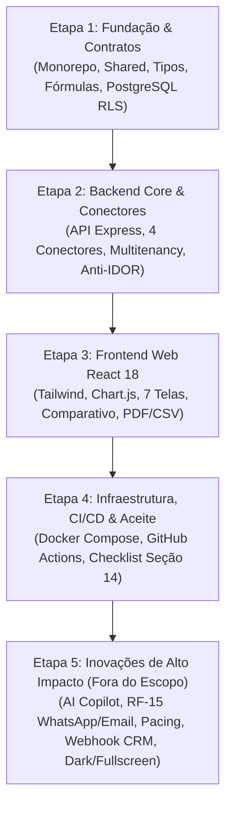
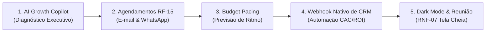

# Documentação das Etapas de Implementação
### Plataforma de Analytics Multicliente para Agência de Marketing Digital

Este documento consolida o **Roteiro Cronológico e Técnico de Todas as Etapas do Projeto**, desde os alicerces de arquitetura do escopo base do edital/PDF até a concepção e entrega das **5 inovações de alto impacto** que foram agregadas além do escopo inicial.

---

## 🗺️ Visão Geral das Etapas



---

## 📌 Etapa 1: Fundação de Arquitetura, Contratos e Banco de Dados

### 1.1 Objetivos
* Estruturar o monorepo padronizado com separação estrita de responsabilidades (`packages/shared`, `apps/api`, `apps/web`).
* Definir contratos TypeScript, tipagens de domínio e esquemas Zod reutilizáveis.
* Implementar o **Dicionário Formal de Métricas** com respeito irrestrito à regra de agregação de razões (RF-03).
* Modelar o banco de dados PostgreSQL 16 com suporte nativo a **Row Level Security (RLS)** para isolamento absoluto entre clientes da agência.

### 1.2 Entregáveis Técnicos
* **Pacote Compartilhado**: [`packages/shared`](file:///c:/Projetos/DashBoardAnalytics/packages/shared)
  * [`src/types/index.ts`](file:///c:/Projetos/DashBoardAnalytics/packages/shared/src/types/index.ts): interfaces para `Cliente`, `Usuario`, `ContaConectada`, `FatoAdsDiario`, `FatoGa4Diario`, `FatoInstagramDiario`, `EntradaManual`, `MetaAlerta`, `RelatorioGerado`, `AgendamentoRelatorio`.
  * [`src/utils/metrics.ts`](file:///c:/Projetos/DashBoardAnalytics/packages/shared/src/utils/metrics.ts): funções formais `calcularCTR`, `calcularCPC`, `calcularCPM`, `calcularCPA`, `calcularROAS`, `calcularROI`, `calcularCAC`, `formatarMoeda`, `formatarNumero`, `formatarPercentual` e semântica invertida de custo `isCustoMetrica`.
  * [`src/schemas/index.ts`](file:///c:/Projetos/DashBoardAnalytics/packages/shared/src/schemas/index.ts): esquemas de validação Zod para filtros de data, paginação, entradas manuais e autenticação.
* **Modelagem Relacional & Segurança**:
  * [`database/migrations/001_initial_schema.sql`](file:///c:/Projetos/DashBoardAnalytics/database/migrations/001_initial_schema.sql): 14 tabelas normalizadas, índices de performance em `(cliente_id, data DESC)`, e ativação de RLS (`ALTER TABLE ... ENABLE ROW LEVEL SECURITY`) com política `USING (cliente_id = CURRENT_SETTING('app.cliente_ids')::uuid)`.
  * [`database/seeds/002_initial_seed.sql`](file:///c:/Projetos/DashBoardAnalytics/database/seeds/002_initial_seed.sql): seed estruturado para testes com mais de 60 clientes, campanhas reais e histórico de 90 dias.
* **Testes de Unidade**:
  * [`packages/shared/test/metrics.test.ts`](file:///c:/Projetos/DashBoardAnalytics/packages/shared/test/metrics.test.ts): 14 testes cobrindo divisão por zero, arredondamentos e agregação não linear de razões.

---

## 📌 Etapa 2: Backend Core, Conectores e Segurança Multitenant

### 2.1 Objetivos
* Desenvolver a API REST em Node.js com Express e TypeScript.
* Implementar a interface extensível `Conector` e os 4 conectores oficiais do escopo (GA4, Google Ads, Meta Ads e Instagram Insights).
* Criar a camada de autenticação com isolamento rigoroso entre contas de clientes e administradores da agência (RF-07 e RF-08).
* Proteger todos os endpoints contra vulnerabilidades de autorização direta a objetos (anti-IDOR).

### 2.2 Entregáveis Técnicos
* **Conectores Modulares**: [`apps/api/src/connectors/index.ts`](file:///c:/Projetos/DashBoardAnalytics/apps/api/src/connectors/index.ts)
  * `GA4Conector`: sessões, engajamento, taxa de rejeição, conversões e canais.
  * `GoogleAdsConector`: impressões, cliques, investimento, conversões de pesquisa/display/vídeo.
  * `MetaAdsConector`: campanhas de Facebook Ads com alcance, frequência e leads.
  * `InstagramConector`: métricas modernas incluindo *Views* (nova diretriz da Meta), alcance, seguidores e engajamento.
* **Camada de Dados & Isolamento**:
  * [`apps/api/src/db/postgres.ts`](file:///c:/Projetos/DashBoardAnalytics/apps/api/src/db/postgres.ts): driver de banco que injeta `SET LOCAL app.cliente_ids` na sessão antes de cada consulta.
  * [`apps/api/src/middleware/auth.ts`](file:///c:/Projetos/DashBoardAnalytics/apps/api/src/middleware/auth.ts): middleware `isolamentoClienteMiddleware` que intercepta requisições e rejeita qualquer tentativa de um usuário acessar dados de outro cliente (`403 Forbidden`).
* **Serviços de Negócio**:
  * [`apps/api/src/services/metricsService.ts`](file:///c:/Projetos/DashBoardAnalytics/apps/api/src/services/metricsService.ts): agregações de métricas consolidando período atual versus período anterior homólogo (mesma quantidade de dias), cálculos de série temporal diária e detalhamento por campanha.
  * [`apps/api/src/services/alertService.ts`](file:///c:/Projetos/DashBoardAnalytics/apps/api/src/services/alertService.ts): validação de desvios operacionais (ex: CPA estourado, queda abrupta de CTR ou queda de token de conexão).
* **Testes de Segurança**:
  * [`apps/api/test/multitenancy.test.ts`](file:///c:/Projetos/DashBoardAnalytics/apps/api/test/multitenancy.test.ts): testes de penetração simulando tentativas de acesso cruzado entre clientes.

---

## 📌 Etapa 3: Interface Web Moderna, Componentes Analíticos e Exportação

### 3.1 Objetivos
* Construir a interface do usuário com React 18, Vite, Tailwind CSS e Chart.js.
* Oferecer navegação fluida, visualização executiva e 7 visões especializadas para atender tanto os gestores de tráfego quanto os clientes finais.
* Implementar a barra de filtros fixa com atalhos de tempo (7D, 30D, 90D, Mês Atual) e modo comparativo com períodos anteriores (RF-04 e RF-05).
* Gerar relatórios executivos em PDF com a identidade visual da agência (RF-06) e exportações de dados em CSV estruturado (RF-17).

### 3.2 Entregáveis Técnicos
* **Componentes Reutilizáveis**:
  * `Header.tsx`: navegação entre clientes, status de sincronização em quase tempo real (RF-11), alternador de tema e seletor rápido de perfis de teste (Admin, Gestor, Cliente).
  * `FilterBar.tsx`: seletores de data, presets de 7/30/90 dias, alternância do modo comparativo e switches de canais.
  * `KpiCard.tsx`: cards de métricas com variação percentual, badge de status, semântica de cores invertida para métricas de custo e tooltip com a fórmula matemática aplicada.
  * `TrendChart.tsx`: gráficos temporais em Chart.js com linha contínua para o período selecionado e linha tracejada estilizada `[6, 4]` para o período anterior homólogo.
  * `ChannelDonut.tsx`: divisão proporcional de investimento e resultados por canal de mídia.
  * `ReportPrintView.tsx`: template profissional de relatório A4 com logotipo da agência, dados do cliente e quebras de página controladas para exportação limpa via `window.print()`.
* **7 Visões Especializadas**:
  1. `OverviewView.tsx`: visão macro consolidada com KPIs de topo de funil, conversões e gráficos de tendência.
  2. `PaidAdsView.tsx`: visão aprofundada de Google Ads e Meta Ads com tabela de desempenho por campanha.
  3. `GA4View.tsx`: análise de tráfego orgânico/pago, sessões, taxa de engajamento e conversões do Google Analytics 4.
  4. `InstagramView.tsx`: cards de publicações de maior engajamento, visualizações de reels e crescimento de audiência.
  5. `ManualEntriesView.tsx`: formulário e histórico de faturamento e clientes para cálculo de CAC e ROI reais (RF-12).
  6. `ConnectionsView.tsx`: tela de saúde de integrações com status das contas e botão de sincronização sob demanda (RF-10).
  7. `AlertsView.tsx`: central de metas e anomalias de campanhas (RF-16).
  8. `BrandSettingsView.tsx`: personalização visual da agência (cores, nome, logotipo e rodapé) (RF-14).

---

## 📌 Etapa 4: Infraestrutura, Pipeline CI/CD e Checklist de Aceite

### 4.1 Objetivos
* Conteinerizar todas as aplicações via Docker e Docker Compose para execução isolada em um comando.
* Configurar o pipeline de integração contínua (CI/CD) no GitHub Actions.
* Automatizar a auditoria dos critérios de aceite estipulados na Seção 14 do documento de requisitos original.
* Registrar o repositório no GitHub (`https://github.com/PauloHFA/Dashboard-Analytics.git`) e configurar o usuário de homologação solicitado (`rickphtb@gmail.com`).

### 4.2 Entregáveis Técnicos
* **Conteinerização**:
  * [`docker-compose.yml`](file:///c:/Projetos/DashBoardAnalytics/docker-compose.yml): orquestração de 4 serviços (`postgres`, `redis`, `api`, `web`).
  * `apps/api/Dockerfile`: imagem de produção Node.js alpine multi-stage.
  * `apps/web/Dockerfile` & `apps/web/nginx.conf`: build estático servido por Nginx otimizado com compressão gzip e roteamento SPA.
* **Automação de CI/CD**:
  * [`.github/workflows/ci.yml`](file:///c:/Projetos/DashBoardAnalytics/.github/workflows/ci.yml): execução automática em pull requests e push na branch `main`.
* **Auditoria de Critérios de Aceite**:
  * [`scripts/acceptance_check.ts`](file:///c:/Projetos/DashBoardAnalytics/scripts/acceptance_check.ts): script que valida matematicamente 5 cenários críticos da Seção 14 do edital:
    1. Agregação correta de CTR, CPC e CPA (evitando média de médias).
    2. Semântica invertida de cores para métricas de custo (queda de CPA = positivo).
    3. Cálculo de CAC e ROI condicionado à existência de receita de CRM/Entrada Manual.
    4. Isolamento estrito de multitenancy (bloqueio de IDOR entre clientes).
    5. Frequência de atualização em quase tempo real com tolerância inferior a 60 minutos.

---

## 📌 Etapa 5: Inovações de Alto Impacto (Implementações Fora do Escopo Base)

Em resposta à evolução do produto e às melhores práticas de plataformas modernas de BI para marketing, foram adicionados **5 módulos de alto valor agregado**, executados rigorosamente na sequência solicitada:



### 5.1 Inovação 1: AI Growth Copilot (Parecer Executivo Inteligente)
* **Problema Resolvido**: Gestores de conta gastavam horas redigindo relatórios analíticos manuais no WhatsApp para clientes.
* **Implementação**:
  * Serviço backend desacoplado [`apps/api/src/services/aiCopilotService.ts`](file:///c:/Projetos/DashBoardAnalytics/apps/api/src/services/aiCopilotService.ts).
  * Endpoint `POST /api/v1/ia/parecer`.
  * Componente front-end [`apps/web/src/components/AiExecutiveSummaryCard.tsx`](file:///c:/Projetos/DashBoardAnalytics/apps/web/src/components/AiExecutiveSummaryCard.tsx).
* **Entregas**: Score de Saúde de 0 a 100, identificação de anomalias, resumo executivo, destaques positivos, pontos de atenção, recomendações táticas e botão *"Copiar Parecer para WhatsApp"*.

### 5.2 Inovação 2: Agendamento & Disparo Automático (RF-15)
* **Problema Resolvido**: Dependência de exportação manual de PDFs no fechamento de mês.
* **Implementação**:
  * Endpoints REST `/api/v1/clientes/:id/agendamentos` no backend.
  * Suporte a frequências: Semanal (segundas), Quinzenal (dias 1 e 15) e Mensal (dia 1º).
  * Canais de envio: E-mail (lista de destinatários) e Webhook de WhatsApp (mensageria automatizada para grupos de clientes).
  * Gestor de agendamentos integrado na tela de Relatórios (`apps/web/src/views/ReportsView.tsx`).

### 5.3 Inovação 3: Budget Pacing & Run-rate (Previsão Financeira de Mídia)
* **Problema Resolvido**: Campanhas que esgotavam a verba antes do fim do mês ou sobravam orçamento contratado.
* **Implementação**:
  * Serviço matemático [`apps/api/src/services/pacingService.ts`](file:///c:/Projetos/DashBoardAnalytics/apps/api/src/services/pacingService.ts).
  * Endpoint `GET /api/v1/clientes/:id/pacing`.
  * Componente front-end [`apps/web/src/components/BudgetPacingCard.tsx`](file:///c:/Projetos/DashBoardAnalytics/apps/web/src/components/BudgetPacingCard.tsx).
* **Entregas**: Cálculo do ritmo diário atual, projeção de fechamento (*run-rate*), cálculo do ritmo diário recomendado e barra de progresso comparando o consumo real contra a curva ideal do mês.

### 5.4 Inovação 4: Webhook Nativo de CRM & E-commerce
* **Problema Resolvido**: Dependência de digitação manual diária de dados comerciais na tela de Entradas Manuais para alimentar CAC e ROI.
* **Implementação**:
  * Endpoint público de ingestão: `POST /api/v1/webhooks/crm/:clienteId`.
  * Integrador automático com RD Station, HubSpot, ActiveCampaign ou sistemas de PDV.
  * Simulador de webhook interativo na interface [`apps/web/src/views/ManualEntriesView.tsx`](file:///c:/Projetos/DashBoardAnalytics/apps/web/src/views/ManualEntriesView.tsx) para testes sem necessidade de ferramentas externas (ex: Postman ou cURL).

### 5.5 Inovação 5: Dark Mode & Apresentação em Tela Cheia (RNF-07)
* **Problema Resolvido**: Atendimento ao Requisito Não Funcional 07 (*"Responsivo, legível em tela cheia de reunião"*).
* **Implementação**:
  * Modo escuro completo com classes Tailwind CSS (`darkMode: 'class'`).
  * Alternador de tema persistente no cabeçalho.
  * Botão de **Modo Apresentação (Tela Cheia)** que aciona a API nativa `requestFullscreen()`, ocultando barras do navegador para projeção em TVs de reuniões de diretoria.

---

## 🧪 Matriz de Verificação e Testes Automatizados

O projeto conta com **32 testes automatizados** distribuídos entre testes unitários, testes de integração e testes de segurança:

| Arquivo de Testes | Quantidade | Foco Principal |
|---|---|---|
| [`packages/shared/test/metrics.test.ts`](file:///c:/Projetos/DashBoardAnalytics/packages/shared/test/metrics.test.ts) | 14 testes | Precisão matemática de fórmulas, arredondamento e agregação correta de razões. |
| [`apps/api/test/multitenancy.test.ts`](file:///c:/Projetos/DashBoardAnalytics/apps/api/test/multitenancy.test.ts) | 6 testes | Isolamento de tenants, validação anti-IDOR e bloqueio de clientes não autorizados. |
| [`apps/api/test/alerts_reports.test.ts`](file:///c:/Projetos/DashBoardAnalytics/apps/api/test/alerts_reports.test.ts) | 4 testes | Disparo de alertas de CPA/ROAS e geração de relatórios com identidade visual da agência. |
| [`apps/api/test/extended_features.test.ts`](file:///c:/Projetos/DashBoardAnalytics/apps/api/test/extended_features.test.ts) | 8 testes | AI Copilot, Webhook de CRM, Budget Pacing e Agendamentos automáticos. |

Para rodar todos os testes localmente:
```bash
npm test
```

Para rodar a checagem dos critérios de aceite da Seção 14 do PDF:
```bash
npm run check:acceptance
```
